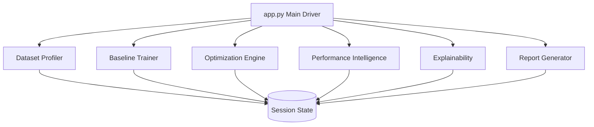

# 🧠 OptiMind Studio – Performance-Aware ML Optimization Platform


OptiMind Studio is a professional-grade ML optimization platform that bridges the gap between **Model Accuracy** and **Computational Efficiency**. Designed for developers and MLOps engineers, it systematically audits models to find the "Performance Golden Tier"—the perfect balance between high accuracy and low training latency.

## 🚀 Key Features

- **Modular Developer Workflow:** A multi-step pipeline covering Data Profiling, Baseline Auditing, and Intelligent Optimization.
- **Model Comparison Mode:** Simultaneous optimization of multiple architectures (Logistic Regression, Random Forest).
- **Efficiency Intelligence:** Introduces the **Efficiency Score** (Accuracy / Training Time) to guide production scaling decisions.
- **Overfitting Guard:** Automated train-vs-test variance analysis to detect generalization gaps.
- **Advanced Explainability:** 
  - Parallel Coordinate plots for high-dimensional hyperparameter relationships.
  - Optimization History & Parameter Importance.
  - Global Feature Importance for model transparency.
- **Automated Reporting:** One-click download of a comprehensive Markdown report containing executive recommendations and optimal hyperparameters.

## 🏗️ Modular Architecture

OptiMind Studio is built with a highly decoupled, scalable architecture:



- **`modules/profiler.py`**: Dynamic CSV ingestion and statistical profiling.
- **`modules/baseline.py`**: Split-data validation and overfitting auditing.
- **`modules/optimizer.py`**: Optuna-powered multi-model hyperparameter tuning.
- **`modules/analyzer.py`**: Performance trade-off visualization and recommendation engine.
- **`modules/explainability.py`**: Advanced hyperparameter and feature analysis.
- **`modules/tracker.py`**: State-to-Report compilation engine.

## 🛠️ Installation & Setup

Ensure you have Python 3.9+ installed, then follow these steps:

1. **Clone the repository:**
   ```bash
   git clone https://github.com/your-username/optimind-studio.git
   cd optimind-studio
   ```

2. **Set up a virtual environment:**
   ```bash
   python -m venv venv
   source venv/bin/activate  # On Windows: venv\Scripts\activate
   ```

3. **Install dependencies:**
   ```bash
   pip install -r requirements.txt
   ```

4. **Launch the Studio:**
   ```bash
   streamlit run app.py
   ```

## 🏆 Hackathon Positioning

While most ML tools focus solely on accuracy, **OptiMind Studio** addresses the critical production bottleneck: **Compute Cost**. By explicitly measuring and optimizing for efficiency, this tool enables companies to reduce their carbon footprint and cloud compute bills while maintaining elite-tier model performance.

---
*Created for the Innovation Hackathon 2026*
